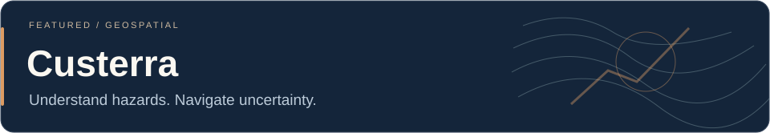
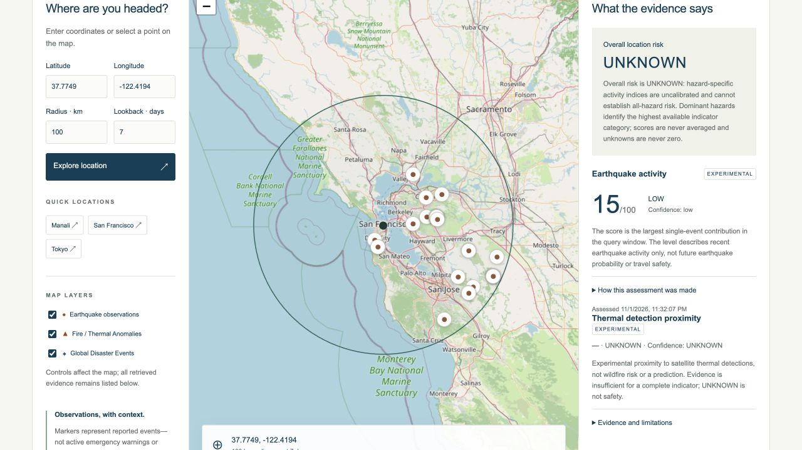
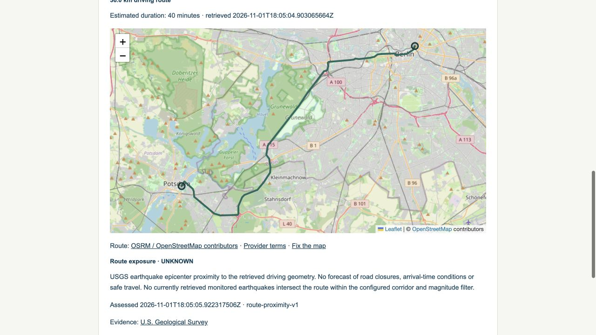
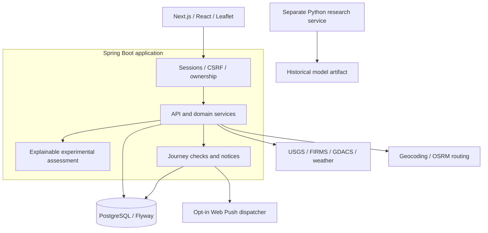

<p align="center"></p>

<p align="center"></p>

<p align="center">  </p>

Custerra is a geospatial natural-hazard intelligence application for **location awareness, route exposure and monitored journeys**. It brings reported observations, their sources and their coverage limits into a coherent map and journey workflow.

[Documentation](docs/overview.md) · [Get started](docs/getting-started.md) · [API reference](docs/api-design.md) · [Engineering checks](docs/verification.md) · [Roadmap](https://github.com/Ap-95671/custerra/issues) · [Staging preview](https://custerra-v2-staging.onrender.com)

## Why Custerra?

Hazard information is spread across catalogs, satellite products, advisory feeds and weather services. Custerra places that evidence in geographic context, then carries it into route and journey workflows—with provenance, timestamps and uncertainty kept visible.

It helps answer **“What has been reported around this place or route?”** Overall risk stays UNKNOWN; the application does not determine that travel is safe.

## Current capabilities

| Area | What the application supports |
| --- | --- |
| **Natural-hazard intelligence** | Bounded USGS observations, FIRMS thermal detections and GDACS advisories; geographic/time filters; per-source freshness, availability and coverage. FIRMS live acceptance is pending a key. |
| **Geospatial exploration** | Interactive Leaflet maps, coordinate selection, place-name search, independent hazard layers and source-linked event details. |
| **Routes & journeys** | Origin/destination driving geometry, earthquake epicenter proximity, full generated-route saving, lifecycle states, optional expiring progress and conservative remaining-route checks. |
| **Evidence & notices** | Provider-specific baselines, meaningful evidence-change detection, owned in-app notices and notification preferences. Optional Web Push queue/dispatch infrastructure is implemented; native-device acceptance continues. |
| **Offline support** | Explicit read-only browser copies of a journey and saved evidence, with source timestamps, expiry and sign-out cleanup. No map-tile packs or offline monitoring. |
| **Developer platform** | A separate scoped B2B API, revocable API credentials, quotas, usage records and an OpenAPI contract for supported USGS-based operations. |

These capabilities describe the **V2 release candidate**. The application runtime on the default branch remains the earlier release until its separate acceptance and rollout decision. The setup below selects the V2 candidate explicitly. Documentation updates do not deploy either runtime.

## Product previews

The images below are authentic **staging previews**, using public test locations and a synthetic account. They are not production acceptance evidence.

### Location intelligence



### Route exposure



[Read-only journey copy and capture context](docs/assets/screenshots/README.md). Map data © [OpenStreetMap contributors](https://www.openstreetmap.org/copyright); earthquake evidence: [USGS](https://earthquake.usgs.gov/fdsnws/event/1/); routing: OSRM / OpenStreetMap contributors.

The [free staging preview](https://custerra-v2-staging.onrender.com) can sleep or stop at resource limits. Background monitoring and outbound push are disabled. Weather returned an upstream 502 in the latest bounded acceptance run; unavailable evidence is shown explicitly.

## System architecture



Authentication and domain modules are part of the backend, rather than separate deployed microservices. The hosted frontend uses a same-origin API proxy; operational diagnostics remain private. Journey scheduling and push dispatch are optional and disabled in the free preview. The research service is **research-only** and does not feed live risk scores or notifications.

[Architecture and boundaries](docs/overview.md) · [Database](docs/database-design.md) · [Authentication](docs/authentication.md)

## Technology stack

| Layer | Technologies |
| --- | --- |
| Backend |    Java 21, Spring Boot, Spring Security, JPA/JDBC |
| Frontend |    TypeScript, React, Next.js, Leaflet, Zod |
| Data |  PostgreSQL 17 and versioned Flyway migrations |
| Delivery |   Docker, GitHub Actions, free Render/Neon staging |
| Research |     Python, FastAPI, NumPy and scikit-learn evaluation |
| Testing | JUnit, PostgreSQL integration fixtures, Vitest, Playwright and pytest |

Icons: [Devicon](https://github.com/devicons/devicon), [MIT notice](docs/assets/licenses/devicon-MIT.txt). Technology marks remain their owners’ property.

## Data providers

| Provider | Role | Verification and limits |
| --- | --- | --- |
| **USGS** | Earthquake catalog observations | Live-verified in bounded tests and the staging map. Revisions, truncation and incomplete event metadata remain possible. |
| **NASA FIRMS / LANCE** | Satellite thermal anomalies | Adapter and fixtures implemented; live authentication/nonempty-row acceptance pending an authorized MAP_KEY. Detections are not confirmed wildfires. |
| **GDACS** | Recent disaster advisories | Bounded live feed parsing verified; feed scope is partial and source availability can vary. Advisory points are not complete impact polygons. |
| **Open-Meteo / GeoNames** | Place search | Live place lookup verified in staging; attribution and hosted-service limits apply. |
| **Open-Meteo weather** | Modeled environmental context | Integration implemented; latest actual staging weather check returned 502. It does not alter hazard risk scores. |
| **OSRM / OpenStreetMap** | Driving route geometry | Real public-city routes verified; no live traffic, road-closure or hazard-aware navigation guarantee. |
| **OpenStreetMap tiles** | Browser map imagery | Visible attribution and normal caching; no bulk/offline tile prefetch or availability guarantee. |

Hosted service entitlement and data licences are separate. Free Open-Meteo service access is non-commercial; routing, tiles and downstream redistribution have their own conditions. No paid provider subscription is included. [Provider details](docs/data-sources.md) · [Third-party notices](THIRD_PARTY_NOTICES.md)

## Getting started

Requirements: **JDK 21, Maven, Node.js 24/npm and a dedicated PostgreSQL 17 database**. Python 3.14 is optional for the separate research service.

```sh
git clone --branch release/v2-candidate https://github.com/Ap-95671/custerra.git
cd custerra
cp .env.example .env
```

Create an isolated local database/role and set local credentials in `.env`. Export that trusted file, then start the API:

```sh
set -a
. ./.env
set +a
mvn -f backend/pom.xml spring-boot:run
```

In a second terminal:

```sh
cd frontend
npm ci
npm run dev
```

Open [localhost:3000](http://localhost:3000). The API binds to [localhost:8080](http://localhost:8080/api/v1/health). PostgreSQL must be reachable for normal startup; Flyway applies migrations before Hibernate validates the schema.

[Database creation, environment variables and troubleshooting](docs/getting-started.md) · [Optional research setup](docs/ml.md). Never commit `.env`, use a production database for tests or put secrets in `NEXT_PUBLIC_*` variables.

## API documentation

A small public-data query:

```sh
curl 'http://localhost:8080/api/v1/hazards/nearby?latitude=52.52&longitude=13.405&radiusKm=25&days=1'
```

API liveness:

```sh
curl 'http://localhost:8080/api/v1/health'
```

[Consumer API contracts](docs/api-design.md) · [B2B API guide](docs/b2b-api.md) · [OpenAPI specification](docs/b2b-openapi.yaml). Liveness is not provider readiness, hazard completeness or a safety determination. Account-owned operations require the documented session/CSRF or scoped-key boundary.

## Testing & engineering quality

The **November 1, 2026 V2 baseline** passed 205 backend/database tests (three opt-in live skips), frontend lint/build/type checks, 27 frontend unit tests, 26 browser tests, five research tests and 12 script tests. All four container images built; private monitoring-rule fixtures passed.

**The overall security workflow remains failed.** Dependency/container findings, native-device acceptance and operational recovery remain visible release gates. The latest bounded HTTPS staging suite recorded **40 passes and one weather failure**; separate route-progress and browser offline-copy/sign-out checks passed.

```sh
mvn -f backend/pom.xml verify
cd frontend
npm run lint
npm test
npm run build
npm run typecheck
npm run test:e2e
```

[Exact test scope, integration setup and CI evidence](docs/verification.md). Ordinary fixtures do not establish live-provider reliability, native push receipt/display or production safety. Documentation-only updates skip repeated cloud builds; no test total or coverage percentage is invented.

## Development progress

| Component | Current state |
| --- | --- |
| Interactive hazard exploration | Implemented; bounded live/staging verification |
| Origin/destination route planning | Implemented; real geometry verified |
| Generated-route journeys & progress | Implemented on V2 candidate; bounded HTTPS verification |
| Multi-hazard coverage | Partial provider coverage; live FIRMS acceptance pending |
| Journey checks and evidence changes | Implemented; positive-event/continuous-worker acceptance ongoing |
| Notification infrastructure | Implemented; supported-device receipt/display acceptance ongoing |
| Offline journey copies | Implemented; save/read/sign-out verified; actual disconnection acceptance pending |
| Scoped B2B API | Implemented; authorization/quota/revocation checks pass |
| Historical research classifier | Research only; separate from operational decisions |
| Security and production reliability | Under validation; production rollout not approved |

## Roadmap

The immediate focus is accepted security fixes, live FIRMS verification, supported notification devices, dependable monitoring/alerts and compatible recovery. Future work includes official-warning feeds, richer affected-area geometry, event correlation, shared provider-rate budgets, better offline/mobile workflows and independent scientific validation.

[Track the actual engineering work](https://github.com/Ap-95671/custerra/issues). Open issues have concrete acceptance criteria; future ideas are not presented as shipped features.

## Scientific limitations

Custerra does not predict earthquakes, guarantee travel safety or replace official warnings. Worldwide coverage is incomplete. Some indicators are experimental; reported-point proximity is not affected-area intersection or an estimate of future loss. Empty results and absent notices do not establish safety.

Follow local government and emergency instructions. [Scientific and operational limits](docs/limitations.md) · [Research model card](docs/ml.md)

## Contributing & security

Read [CONTRIBUTING.md](CONTRIBUTING.md), [SECURITY.md](SECURITY.md) and [CODE_OF_CONDUCT.md](CODE_OF_CONDUCT.md). Use the [issue forms](.github/ISSUE_TEMPLATE) and [pull request checklist](.github/PULL_REQUEST_TEMPLATE.md) for reproducible, focused changes.

Sensitive vulnerabilities, credentials and private locations must not go in public issues. Use **Security → Report a vulnerability** for private security findings when that flow is available; see [SECURITY.md](SECURITY.md). No response-time or bug-bounty promise is made.

## Licence & maintainer

Owner-controlled application code is licensed under **[Apache-2.0](LICENSE)**, approved by the owner on November 2, 2026. See [licensing scope](LICENSING.md) and [NOTICE](NOTICE). Third-party components, data, screenshots and brand rights retain their separate terms. Public source availability does not imply production security acceptance or scientific validation.

Maintained by [Abhishek Prajapati](https://github.com/Ap-95671) · [LinkedIn](https://www.linkedin.com/in/abhishek-prajapati-a05252254/)
