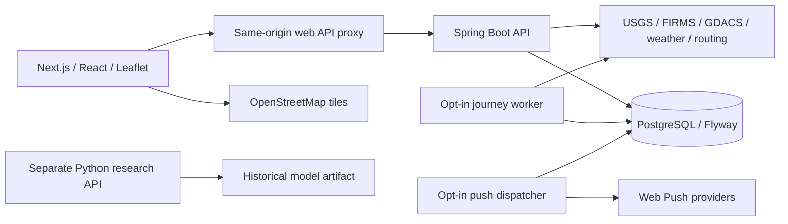

<p align="center"></p>

# Custerra

Geospatial natural-hazard evidence, location context, route exposure and monitored journeys.

Custerra brings observations and their sources into one map and journey workflow. It helps explore what has been reported near a place or route, while keeping missing coverage and uncertainty visible. **It does not determine that a location or journey is safe.**

[Get started](docs/getting-started.md) · [Architecture](docs/overview.md) · [API](docs/api-design.md) · [Verification](docs/verification.md) · [Limitations](docs/limitations.md)

## What it does

- Explore nearby USGS earthquakes, NASA FIRMS thermal anomalies and GDACS advisories with timestamps, provenance and independent coverage states.
- Search places, retrieve a driving route and assess earthquake epicenter proximity to its geometry.
- Save full generated routes, explicitly activate a journey, share an optional expiring position and check the remaining route conservatively.
- Keep account-owned journeys, historical earthquake snapshots and informational notices.
- Save an explicit read-only journey copy in the browser, including source timestamps and expiry. Signing out removes local copies.
- Expose a separate scoped B2B API for supported USGS-based operations, with quotas and revocable credentials.

Monitoring and outbound web push are opt-in server capabilities. They are disabled on the free demos. Satellite thermal anomalies are not confirmed wildfires; nearby reported points are not affected-area or road-closure intersections.

## See the application


Map data © [OpenStreetMap contributors](https://www.openstreetmap.org/copyright); earthquake observations: [USGS](https://earthquake.usgs.gov/fdsnws/event/1/); route: OSRM / OpenStreetMap contributors. These are authentic screenshots of the running staging application using public test locations. [Capture context and more views](docs/assets/screenshots/README.md).

## Project status

**Development / release review.** The repository remains private; no production release or open-source licence is declared.

| Area | Implemented and verified scope |
| --- | --- |
| Map and evidence | On-demand public providers, source-isolated failures and explicit UNKNOWN/partial states |
| Routes and journeys | Full generated geometry, lifecycle, owned records and opt-in progress; bounded actual HTTPS staging checks passed |
| Separate staging | Render Free and independent Neon Free PostgreSQL 17; all eleven migrations succeeded |
| Weather | Integration exists; the latest staging run returned upstream HTTP 502 |
| FIRMS | Adapter/fixtures implemented; live acceptance pending an authorized MAP_KEY |
| Web push | Queue/dispatcher and fixture coverage implemented; fresh physical-device receipt/display acceptance pending |
| Security and operations | Strict CI exposes unresolved findings; independent review, operational alerts, live preservation and compatible rollback remain open |
| Research | Separate retrospective classification experiment; not used by live risk or notifications |

The latest technical baseline passes backend/database, frontend, browser and research tests. **The overall application workflow fails security gates.** [Exact results and commands](docs/verification.md). Passing fixtures do not substitute for live-provider, native-device or production acceptance.

## Architecture



Workers and push shown above are implemented optional components, disabled in the free demo. The research service has no connection to live risk scoring. [Boundaries, storage and failure behavior](docs/overview.md).

| Layer | Technology |
| --- | --- |
| API | Java 21, Spring Boot, Spring Security, Maven |
| Web | Next.js, React, TypeScript, Leaflet, Zod |
| Persistence | PostgreSQL 17, JPA/JDBC, Flyway V1–V11 |
| Research | Python, FastAPI, NumPy, scikit-learn training/evaluation |
| Verification / delivery | JUnit, Vitest, Playwright, pytest, Docker, GitHub Actions |

## Run locally

Start a dedicated PostgreSQL database, then configure and run the API:

```sh
cp .env.example .env
# Set local database credentials in .env, then export them in a trusted shell.
set -a
. ./.env
set +a
mvn -f backend/pom.xml spring-boot:run
```

In another terminal:

```sh
cd frontend
npm ci
npm run dev
```

Open [localhost:3000](http://localhost:3000). Full prerequisites, database creation, environment configuration and migration safeguards are in [getting started](docs/getting-started.md). Never put a secret in a `NEXT_PUBLIC_*` variable.

## Workflows and documentation

| Workflow | Guide |
| --- | --- |
| Location evidence and experimental indicators | [Data sources](docs/data-sources.md), [risk model](docs/risk-model.md) |
| Routes, lifecycle and progress | [Journeys](docs/history-and-journeys.md) |
| Accounts and ownership | [Authentication](docs/authentication.md) |
| Notices, delivery stages and opt-in push | [Notifications](docs/notifications.md) |
| Read-only local evidence | [Offline copies](docs/offline.md) |
| Scoped external API | [B2B guide](docs/b2b-api.md), [OpenAPI](docs/b2b-openapi.yaml) |
| Historical experiment | [Research model card](docs/ml.md) |
| Deployment and recovery procedures | [Deployment](docs/deployment.md), [synthetic recovery tooling](scripts/verify-encrypted-database-recovery.py) |

## Roadmap

The immediate work is release acceptance: resolve security findings, verify live FIRMS and supported notification devices, establish operational alerting and compatible recovery, and obtain independent review. Broader official-warning coverage, affected-area geometry, distributed provider budgets and external scientific validation remain future work. [Tracked issues](https://github.com/Ap-95671/custerra/issues).

## Limitations, data and rights

Overall risk stays **UNKNOWN**. Experimental activity/proximity indicators are not validated disaster probabilities. Empty results, low observed activity and missing notices do not establish safety. Follow local government and emergency instructions. [Scientific and operational limits](docs/limitations.md).

Provider data, hosted API access and map tiles have separate licences and usage policies. Preserve attribution and source timestamps. Free Open-Meteo hosted access is non-commercial; routing/tile services impose their own limits. Offline journey copies do not download map tiles. [Third-party notices](THIRD_PARTY_NOTICES.md) and [provider details](docs/data-sources.md).

## Contributing, security and licence

Read [CONTRIBUTING.md](CONTRIBUTING.md), [CODE_OF_CONDUCT.md](CODE_OF_CONDUCT.md) and [SECURITY.md](SECURITY.md). Sensitive findings must not go in public issues. External contribution terms and a verified private reporting channel remain release decisions.

**No application software licence has been selected.** Publication would not by itself make the project open source. Third-party components/data retain their own terms; the logo is not offered under an assumed code licence.

Maintained by [Abhishek Prajapati](https://github.com/Ap-95671).
