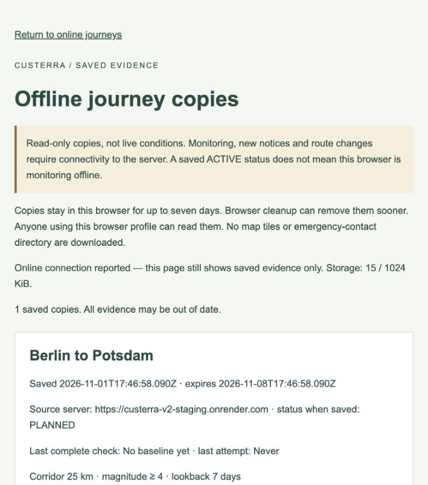

# Authentic application screenshots

Captured from the running, separate Custerra V2 staging application on November 1, 2026, application source `9d044676b7abda01b68024ba9b12aadc9e323596`. Images are native browser JPEG screenshots; no generated mockup, altered observation or fabricated warning is used. They are intentionally a small set rather than a gallery of unverified states.

| Image | Actual context |
| --- | --- |
| [Location explorer](location-explorer.jpg) | Public San Francisco coordinates, real USGS observations, experimental earthquake activity and UNKNOWN overall risk. FIRMS is unconfigured; partial coverage remains explicit. |
| [Driving route](driving-route.jpg) | Public Berlin/Potsdam place search and real OSRM driving geometry, with UNKNOWN earthquake exposure. No private account is shown. |
| [Offline copy](offline-copy.jpg) | Synthetic staging account’s public-city route saved as PLANNED, displayed as read-only saved evidence while connected. Sign-out cleanup was verified separately; this image does not demonstrate network disconnection. |

Map data © [OpenStreetMap contributors](https://www.openstreetmap.org/copyright). Earthquake observations: [U.S. Geological Survey](https://earthquake.usgs.gov/fdsnws/event/1/). Route attribution: OSRM / OpenStreetMap contributors, using the [FOSSGIS public routing service](https://routing.openstreetmap.de/about.html). Viewport screenshots can omit the map footer; attribution is retained here and beside the README images. Provider/map rights remain separate from application software licensing.

No credentials, sessions, real user account information or private location history appear. The visible source-server address identifies an already public test application, not a database/internal administration endpoint. Weather was unavailable during acceptance; no successful weather view or native push display is depicted. Monitoring notices and historical/notification galleries are omitted because no new nonempty controlled-notice/native-delivery acceptance was performed.
