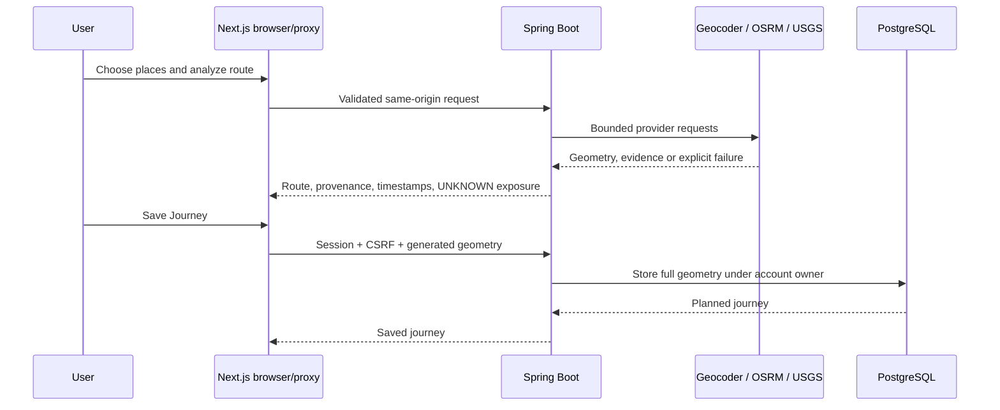

# Architecture overview

Custerra uses a Spring Boot API and a Next.js/React interface. It is a modular application with explicit provider boundaries; empty scaffold files do not represent deployed services.

## Request and data boundaries

The hosted browser calls a same-origin Next.js API proxy. It forwards an allowlisted consumer/B2B API surface to the backend; private actuator and internal operations paths are not publicly proxied. The combined free demo runs the API on loopback. Separate deployment configurations can keep API, database and research services on a private network.

Spring controllers validate request DTOs and delegate to services. Account sessions and CSRF protect owned workflows; repository queries constrain journeys, historical snapshots and inbox items by owner. B2B credentials use a separate stateless boundary with hashed keys, operation scopes, revocation, quotas and usage records.

PostgreSQL stores accounts, owned journeys/history, provider checkpoints/revision evidence, notices, notification queue/attempts and API-client data. Flyway owns schema changes; Hibernate validates. On-demand nearby provider reads do not automatically populate a shared persistent hazard catalog.

## Providers and conservative failure behavior

Adapters normalize USGS earthquakes, FIRMS thermal detections and GDACS advisories while preserving provenance and per-source availability. Weather and geocoding use Open-Meteo; driving geometry uses OSRM; the browser loads attributed OpenStreetMap tiles separately. Timeouts, bounds and source failures remain visible. These sources are not a complete inventory of hazards or official warnings.

## Journey checks and delivery

Manual checks work for active owned journeys. The optional scheduler performs bounded checks on active journeys, with independent source baselines and durable worker diagnostics. A recent, accurate matched position can restrict a check to remaining segments; otherwise it uses the full route. Only the latest explicit position is retained, with expiry and immediate clearing on relevant lifecycle changes.

Eligible notices create owned inbox records and optional delivery rows transactionally. A separate dispatcher claims queue rows and records attempts around bounded external network calls. Queued, attempted, provider-accepted, received and displayed are distinct outcomes. Scheduling/dispatch are disabled on the free staging demo.

## Offline and research

An explicit browser action saves a bounded read-only journey copy with timestamps and expiry. It omits the shared position and downloads no tile packs. It does not monitor while disconnected; signing out removes local copies.

The Python service is a separate historical classification experiment with explicit scope and model artifacts. No live API risk strategy or notification consumes its score. See the [model card](ml.md).

Detailed contracts: [backend decisions](architecture.md), [API](api-design.md), [frontend](frontend.md), [database](database-design.md), [journeys](history-and-journeys.md) and [verification](verification.md).
